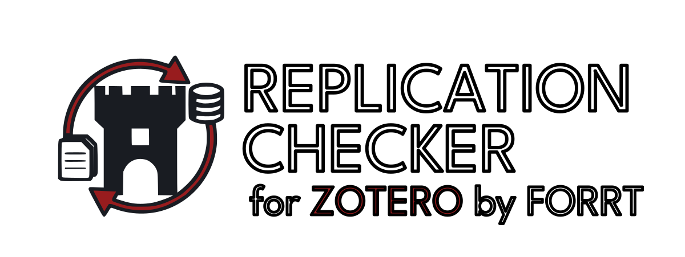

<p align="center">
  
</p>

<!-- Downloads uses /total, not an asset filter: shields appends "[filename]" to the value when filtering, and nothing suppresses it. Keep comments here free of blank lines - a blank line ends the HTML block and the rest of the file gets swallowed. -->
<p align="center">
  <a href="https://github.com/forrtproject/flora-zotero/releases/latest"></a>
  <a href="https://github.com/forrtproject/flora-zotero/releases/latest"></a>
</p>


Replication Checker for Zotero is a free plugin that looks up the papers in your Zotero library in [FLoRA](https://forrt.org/replication-hub/flora/), FORRT's Library of Reproduction and Replication Attempts. When a paper has been replicated or reproduced, the plugin tags it, adds a note listing each attempt and its outcome, and saves the replication studies to your library. Your DOIs are not sent to look them up. Documentation: <https://forrt.org/flora-zotero/>

## Features

- Checks a whole library, a collection or selected items, and checks new items as you add them
- Tags papers that have been replicated or reproduced, with the outcome of each attempt, so you can filter your library
- Adds a note to each paper listing its replications and reproductions, with authors, year, journal, DOI and outcome
- Adds the replication and reproduction studies to your library, inside one `FLoRA` collection, and links them to the original
- Looks up hash fragments of your DOIs rather than the DOIs themselves
- Copies results from read-only group libraries to your personal library
- Lets you ban a replication or reproduction so it is not added again
- Shows how many papers in each library the plugin has identified, and opens them in the [FLoRA Replication Atlas](https://forrt.org/flora-replication-atlas/)
- Available in nine languages

## About the dataset

The plugin uses [FLoRA](https://forrt.org/replication-hub/flora/), FORRT's Library of Reproduction and Replication Attempts, which records replications and reproductions of studies across many areas of science.

A **replication** repeats a study with new data to test whether the finding holds. To be included in FLoRA, a study must:

- say before reporting its results that it is a replication (for example, "replication of Author (Year)"), so that replication was an aim and not only a result;
- name the study or studies it replicates;
- repeat a study or experiment, not only a single association or finding.

Close replications (same methods, same population) and conceptual replications (the same hypothesis tested with different methods) both qualify. Outcomes are recorded as successful, failure or mixed, following how the replication's authors describe their results.

A **reproduction** re-analyses the original study's data to check that the reported results can be obtained. It is coded on two dimensions:

- whether the results were obtained (*computationally successful* or *computational issues*);
- whether they hold under reasonable alternative analyses (*robust*, *robustness challenges* or *robustness not checked*).

If new data are collected, it is a replication. If the same data are re-analysed, it is a reproduction.

FLoRA is incomplete, and a single record is not a verdict on a paper. A replication may test only one study from a multi-study paper. If a replication is missing or a record looks wrong, [report it to the FLoRA team](https://forms.gle/Tn2eqasUU1WE86Dq8).

## Installation

You need Zotero 7 or later. The Zotero documentation explains [how to install and update Zotero](https://www.zotero.org/support/installation).

1. Download `replication-checker-for-zotero.xpi` from the [latest release](https://github.com/forrtproject/flora-zotero/releases/latest).
2. In Zotero, open **Tools → Plugins**.
3. Click the gear icon and choose **Install Plugin From File…**.
4. Select the `.xpi` file you downloaded.

After installation, a short tour offers to check your library straight away. You can skip it and run a check later from the Tools menu.

## Usage

### Collection layout

Everything the plugin adds sits inside one collection, so it does not clutter the top level of your library:

```
FLoRA
├── FLoRA Replications
├── FLoRA Reproductions
├── FLoRA Originals linked to Replications
├── FLoRA Originals linked to Reproductions
└── {LibraryName} [Read-Only]        (one per read-only group library)
```

You can rename the `FLoRA` collection and the four collections inside it, in the plugin's settings or directly in Zotero; the plugin keeps your names. Leave the `[Read-Only]` collections' names as they are: the plugin finds them by name. Libraries organised by earlier versions are reorganised automatically the first time the new version starts. Collections and their items are moved, not recreated.

### Check a whole library

Select a library and choose **Tools → Check Current Library for Replications**. A progress window shows the scan. The check covers whichever library is selected: your personal library or a group library.

In a library you can edit, the plugin tags each paper that has replications or reproductions in FLoRA, adds notes, and adds the replication and reproduction studies to the library's `FLoRA` collection, linked to the original. In a group library, other members of the group see these items too. To see what a check does before running it on everything, start with one collection.

In a read-only group library, the plugin cannot change anything, so it copies the results to your personal library instead. For replications, it shows how many papers have them and asks whether to copy them. If you agree:

- the originals are copied to a `{LibraryName} [Read-Only]` collection in your personal library;
- the replications are copied to `FLoRA Replications` in your personal library;
- both are tagged `Original present in Read-Only Library`, linked to each other, and given the usual notes.

Reproductions are copied in the same way, to `FLoRA Reproductions`.

### Check selected items or collections

Select one or more items or collections, right-click, and choose **Check for Replications**. This works the same way as a library check, in editable and read-only libraries.

### Check newly added items

When you add an item that FLoRA lists, the plugin shows what it found and asks whether to add the details to your library. You can turn this off in the plugin's settings.

### Ban a replication or reproduction

To stop a replication or reproduction from being added again on later checks, right-click it (it carries the tag `Is Replication` or `Is Reproduction`) and choose **Ban Replication**. The same command bans reproductions. After you confirm, the item is moved to the trash and added to your banned list.

The note on the original paper still lists every replication, including banned ones. The ban only stops the item from being added to your library again.

The banned list is stored in Zotero's settings on your computer. You can view it, remove entries or clear it in the plugin's settings.

### Settings

Open **Edit → Settings → Replication Checker for Zotero** (on macOS: **Zotero → Preferences → Replication Checker for Zotero**). There you can:

- turn automatic checking of newly added items on or off (on by default);
- schedule a check of the selected library: disabled, daily, weekly or monthly (default: monthly);
- rename the collections the plugin uses;
- see how many papers in each library the plugin has identified, and open them in the FLoRA Replication Atlas;
- manage your banned list.

## How it works

### Privacy

To look up your items, the plugin:

1. computes the MD5 hash of each DOI;
2. sends the first three characters of each hash to the FLoRA server, up to 200 per request;
3. receives every FLoRA record whose DOI hash starts with one of those characters;
4. compares these records with your DOIs on your computer.

The server never receives your DOIs. There are 4,096 possible three-character codes, so each is shared by a very large number of DOIs, and a code does not show which of them you have. After a match, the plugin looks up the replications it found in the same way, to check whether they replicate more than one original. As with any web request, the server sees your IP address. The FLoRA server does not link requests together or track users.

One feature sends more. **Open in FLoRA Atlas**, in the plugin's settings, opens the [FLoRA Replication Atlas](https://forrt.org/flora-replication-atlas/) with the DOIs of the papers the plugin has tagged in that library in the web address. If the list is too long for a web address, the plugin copies it to the clipboard instead. The Atlas does not link requests together or track users either.

The plugin reads a DOI from an item's DOI field, from a `DOI:` line in the Extra field, or from a `doi.org` link in the URL field. Items without a DOI are not checked.

### What gets added to your items

Tags on papers in your library that FLoRA lists:

| Tag | Meaning |
| --- | --- |
| `Has Been Replicated` | FLoRA lists at least one replication of this paper |
| `Replication: Successful`, `Replication: Failure`, `Replication: Mixed` | The outcome of a replication. A paper with several replications can carry more than one. |
| `Has Been Reproduced` | FLoRA lists at least one reproduction of this paper |
| `Reproduction: Computationally Successful, Robust` (and five similar tags) | The outcome of a reproduction, one tag for each of the six outcomes |

Tags on the replications and reproductions the plugin adds:

| Tag | Meaning |
| --- | --- |
| `Is Replication`, `Is Reproduction` | The item is a replication or reproduction listed in FLoRA |
| Outcome tag | The outcome, as on the original |
| `Replication: Multiple Originals`, `Reproduction: Multiple Originals` | The study replicates or reproduces more than one original. It gets this tag instead of an outcome tag, and an "Original Articles" note listing each original with its DOI and outcome. |
| `Added by Replication Checker` | The plugin added this item or filed it in a `FLoRA` collection |
| `In FLoRA` | FLoRA lists this item: a replication you added yourself, or an original added with **Add Original** |
| `Original present in Read-Only Library` | Copied from a read-only group library |

Tags appear in your Zotero language. Items tagged by earlier versions, for example `Has Replication`, are still recognised.

Each paper with replications also gets a child note listing them, with title, authors, year, journal, DOI and outcome. Reproductions get a separate note. Originals and their replications or reproductions are linked as related items.

The plugin writes these notes and adds newly found replications to them on later checks. Keep your own comments in a separate note.

When a replication is in your library but its original is not, right-click the replication and choose **Add Original** to add it.

### Replication outcomes

The outcome comes from FLoRA's outcome field, which records how the replication's authors interpreted their results. The plugin turns the three outcomes, successful, failure and mixed, into tags so you can filter your library by them. The note shows the outcome for every replication.

### Reproduction outcomes

The outcome comes from FLoRA's outcome field. It combines two judgements: whether the original analysis produced the reported results (*computationally successful* or *computational issues*), and whether the results held up in robustness checks (*robust*, *robustness challenges* or *robustness not checked*). Each of the six combinations has a tag, for example `Reproduction: Computational Issues, Robustness Not Checked`. The note shows the outcome for every reproduction.

### Linked reports

Some studies link to a web address as well as, or instead of, a DOI. This happens when:

- the study has not been published, so it has a web address but no DOI;
- the study is part of a multi-study replication project: the DOI points to the published paper, and the web address to the report for this replication in a public repository such as OSF or Zenodo.

## Data source

The plugin queries FLoRA through a live API (<https://rep-api.forrt.org/v1/prefix-lookup>), so results are as up to date as the database. The API receives only the hash fragments described under [Privacy](#privacy).

## Languages

The plugin follows your Zotero language setting. It is available in:

- English (en-US)
- German (de)
- Spanish (es)
- French (fr)
- Portuguese, Brazil (pt-BR)
- Portuguese, Portugal (pt-PT)
- Arabic (ar)
- Chinese, Simplified (zh-CN)
- Korean (ko)

Menus, dialogs, progress messages, tags, notes and the settings pane are translated, although a few newer messages and the "Original Articles" note are still in English. For example, `Is Replication` becomes `Ist Replikation` in German.

To add a language, see [LOCALIZATION.md](docs/LOCALIZATION.md): copy the English `.ftl` file and translate the strings, keeping the placeholders.

## Citation

If you use the plugin in your research, please cite it:

> Wallrich, L., Tondlekar, R., Weinerova, J., Röseler, L., Baldoni, C., Fouilloux, A., Meier, M., Flores Kanter, P. E., Trajano, I., Vaidis, D. C., Müller, M., Arriaga, P., & Coulson, H. D. (2026). *Zotero Replication Checker* [Software]. <https://doi.org/10.5281/zenodo.18671300>

The repository also includes a `citation.cff` file for citation tools such as GitHub's "Cite this repository" button.

## Feedback

Report bugs or problems with the documentation as a [GitHub issue](https://github.com/forrtproject/flora-zotero/issues), or [send feedback anonymously](https://tinyurl.com/y5evebv9).
